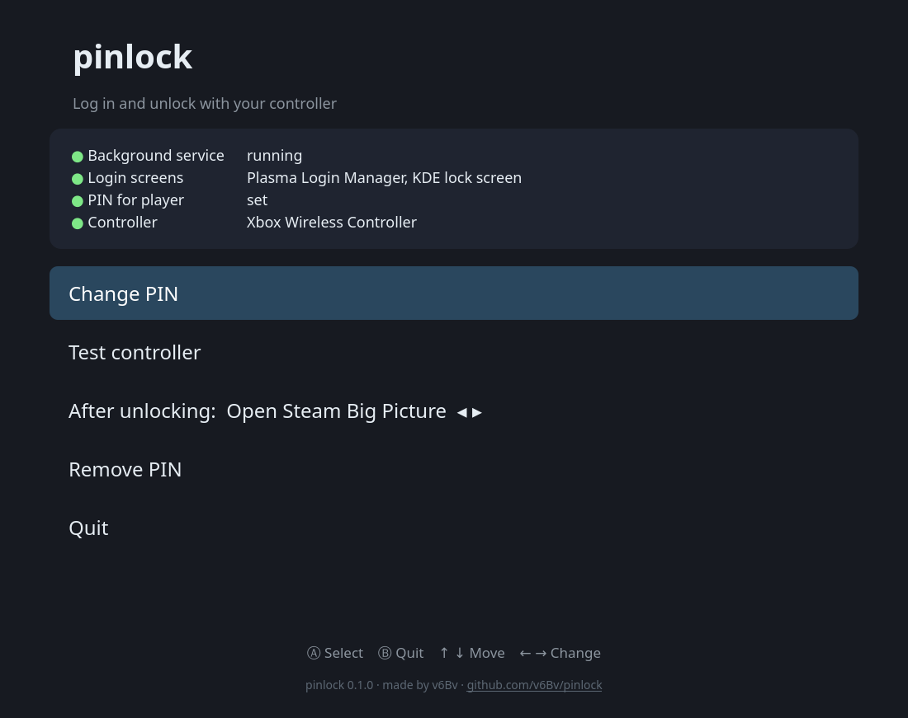
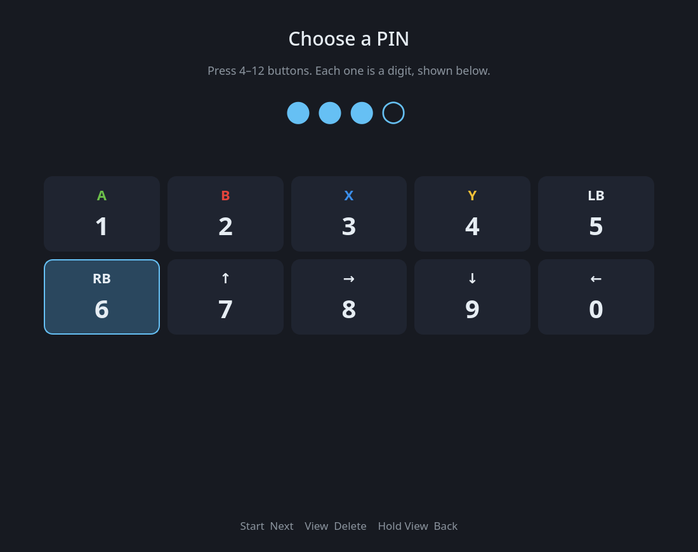

# pinlock

[](https://github.com/v6Bv/pinlock/actions/workflows/ci.yml)
[](LICENSE)


Log in and unlock your Linux PC with a PIN typed on a game controller, the
way an Xbox does it. Made for couch and living-room PCs, Steam machines and
streaming setups (Sunshine/Moonlight). Your normal password keeps working in
the same box.

<p align="center">
  
  
</p>

## Features

- **Controller PIN on the login and lock screens.** Each button types a
  digit into the password box, and Start submits.
- **Your password still works.** Anything that isn't your PIN goes on to
  the normal password check.
- **Steam Big Picture on unlock.** Unlocking with the controller can open
  Big Picture automatically (or run your own command, or do nothing).
- **Setup app you can use from the couch.** Set or change your PIN, test
  your controller and pick what happens on unlock, all with the controller.
  Keyboard and mouse work too.
- **Leaves games alone.** Buttons only type digits while a login or lock
  screen is showing.
- **Safe by default.** PINs are stored as salted scrypt hashes. The
  system's normal lockout (faillock) applies to wrong PINs. sudo, su and SSH
  are never touched.
- **Works with any controller the kernel sees,** including Xbox,
  PlayStation, 8BitDo, Steam Input and Sunshine virtual pads. Pads that
  connect while the screen is up are picked up within a couple of seconds.

| Button | Digit | | Button | Digit |
|---|---|---|---|---|
| A | 1 | | D-pad ↑ | 7 |
| B | 2 | | D-pad → | 8 |
| X | 3 | | D-pad ↓ | 9 |
| Y | 4 | | D-pad ← | 0 |
| LB | 5 | | **Start** | Enter |
| RB | 6 | | **View** | Backspace |

PlayStation-style pads use the same positions: ✕ = A, ○ = B, □ = X, △ = Y.

## Supported screens

| Screen | PAM service | Status |
|---|---|---|
| Plasma Login Manager | `plasmalogin` | ✅ main target |
| KDE lock screen | `kde` | ✅ main target |
| SDDM | `sddm` | 🧪 should work, untested |
| LightDM | `lightdm` | 🧪 should work, untested |
| GDM and the GNOME lock screen | `gdm-password` | 🧪 should work, untested |

pinlock hooks whichever of these are present on your system. Tried one of
the untested ones? Please
[let us know how it went](https://github.com/v6Bv/pinlock/issues/new?template=login_screen_report.yml),
whether it worked or not.

## Install

Requirements: Python 3.9+, `python-evdev`, `polkit`, systemd, and
`python-pyqt6` for the setup app.

```bash
# Arch / CachyOS / Manjaro
sudo pacman -S python-evdev python-pyqt6 polkit

git clone https://github.com/v6Bv/pinlock
cd pinlock
sudo ./install.sh
```

Then open **pinlock** from your app menu (or run `pinlock-setup`) and choose
a PIN with your controller. Lock the screen (Super+L) to try it.

An Arch `PKGBUILD` is in [`packaging/arch`](packaging/arch).

## Command line

```
pinlock status            what's set up, which controllers are connected
pinlock test              show what each button types
sudo pinlock set          set or change your PIN (typed on the keyboard)
sudo pinlock remove       remove your PIN
sudo pinlock pam enable   hook the login/lock screens (install.sh does this)
sudo pinlock pam disable  unhook them
```

`pinlock-setup --fullscreen` starts the setup app full screen (F11 switches).

## How it works

```
controller ──► pinlockd (root) ──► virtual keyboard ──► password box
                  │ only while logind says: greeter or locked
                  ▼
         login/lock screen PAM:  pam_exec ► `pinlock check`   (sufficient)
                                 └─ not the PIN? ► pam_unix (your password)
```

- **`pinlockd`** is a small root service. It watches every controller and
  asks logind whether seat0 is showing the greeter or a locked session. Only
  then does it turn button presses into keystrokes on a virtual uinput
  keyboard.
- **PAM.** `pinlock pam enable` adds one marked block to the login screen
  and lock screen services, before their first `auth` line:
  ```
  auth  required    pam_faillock.so  preauth
  auth  sufficient  pam_exec.so      quiet expose_authtok /usr/local/bin/pinlock check
  ```
  `pinlock check` accepts only 4–12 digit input that matches your stored
  hash. Anything else fails quietly and PAM carries on to your password.
  Because the block is `sufficient`, a broken or missing pinlock install
  can't lock you out; it just falls through to the password.
- **PINs** live in `/etc/pinlock/<user>` as `scrypt` hashes, owned by root
  and readable by your group, since the KDE lock screen checks them as you.
  Changing a PIN needs root, through polkit in the setup app.
- **Unlock action.** If the screen unlocks within 15 s of the controller
  pressing Start, pinlockd runs `pinlock on-unlock` inside your own session.
  It reads `~/.config/pinlock/pinlock.conf`:
  ```ini
  [unlock]
  action = steam        ; steam | none | command
  command = mangohud steam -gamepadui
  ```

## Security notes

- A PIN is a short password: 4 digits is 10,000 combinations. The usual
  faillock lockout (3 wrong tries locks you out for 10 minutes by default)
  also blocks the PIN. Use a longer PIN if strangers can reach your
  keyboard.
- A PIN typed on the keyboard works too, since it's checked the same way.
- Logging in with the PIN doesn't unlock KWallet or GNOME Keyring, which
  need your real password. A login keyring will ask for it once.
- The scrypt hash is readable by your own group, so anything running as you
  could brute-force your PIN offline. Don't reuse it as a bank PIN.

## Uninstall

```bash
sudo ./uninstall.sh
```

This removes the PAM hooks, the service and the files. PINs stay in
`/etc/pinlock` until you delete that folder.

## Development

```bash
make test                  # unit tests (no root needed)
./bin/pinlock-setup        # run the setup app from the checkout
journalctl -u pinlockd -f  # watch the service
```

## Contributing

Bug reports, login screen reports and PRs are welcome. See
[CONTRIBUTING.md](CONTRIBUTING.md). Found a security problem? Please report
it privately: see [SECURITY.md](SECURITY.md).

## License

MIT © [v6Bv](https://github.com/v6Bv). See [LICENSE](LICENSE).
